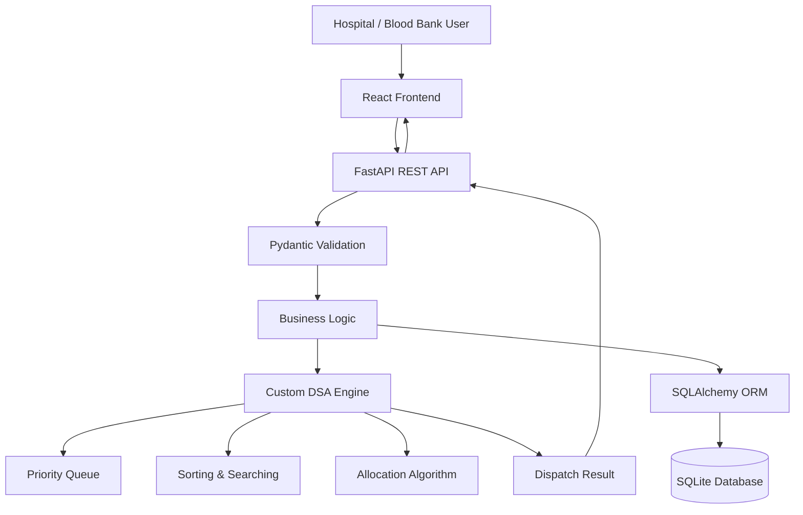

# 🩸 Smart Emergency Blood Allocation & Dispatch Engine

**Prioritize urgent requests. Allocate compatible stock. Reduce expiry waste.**

A full-stack Data Structures & Algorithms (DSA) capstone project that simulates intelligent blood allocation and emergency dispatch for hospitals. The system processes hospital blood requests based on urgency, blood-group compatibility, available inventory, and expiry dates using manually implemented data structures and algorithms.

> ⚠️ **Educational Simulation Only:** This project uses synthetic data and a simplified blood-group compatibility table for educational purposes. It is not clinical decision-support software and must never be used for real blood transfusion decisions.

---

## 📌 Overview

Blood banks must manage inventory with different blood groups, quantities, and expiry dates while responding to hospital requests with varying urgency.

This project demonstrates how fundamental DSA concepts can be applied to a real-world-inspired emergency management problem.

The engine determines:

- Which hospital request should be processed next.
- Whether compatible blood stock is available.
- Which blood units should be allocated first.
- How to minimize unnecessary expiry-related wastage.
- How inventory should be updated after dispatch.

Unlike conventional implementations, the assessed DSA logic is written manually using the Python standard library, without relying on built-in sorting or priority-queue functions.

---

## ✨ Key Features

### 🚨 Emergency Request Management
- Register hospital blood requests.
- Assign different urgency levels.
- Prioritize requests using a custom priority-based mechanism.
- Process urgent requests before less critical requests.

### 🩸 Blood Group Compatibility
- Maintain blood inventory categorized by blood group.
- Check compatibility using a simplified educational compatibility table.
- Identify eligible stock for a particular request.
- Prevent allocation of incompatible units within the simulation.

### 📦 Intelligent Inventory Allocation
- Track blood units, quantities, and expiry dates.
- Allocate eligible stock according to defined rules.
- Prefer suitable stock with earlier expiry dates.
- Update inventory after successful allocation.

### 🚚 Dispatch Management
- Generate simulated dispatch records.
- Track request status and allocated units.
- Maintain inventory consistency after dispatch.
- Identify requests that cannot be fulfilled due to insufficient stock.

### 📊 Dashboard & Visualization
- Monitor blood inventory.
- View hospital requests and their urgency.
- Track allocation and dispatch status.
- Visualize system activity through a modern interface.

### 🧪 Automated Testing
- Backend validation tests.
- API endpoint tests.
- DSA logic verification.
- Inventory and allocation testing.

---

## 🧠 Data Structures & Algorithms

The core assessed logic is implemented manually in `backend/app/dsa/`.

| Data Structure / Algorithm | Application |
|---|---|
| Custom Priority Queue / Heap | Emergency request prioritization |
| Sorting Algorithm | Blood inventory ordering |
| Searching Algorithm | Finding eligible inventory or requests |
| Queue | Request processing and dispatch workflow |
| List / Array | Inventory and request management |
| Greedy Allocation | Selecting suitable blood units |
| Date Comparison | Identifying stock approaching expiry |

**Important:** The assessed DSA implementation does not use built-in sorting or priority-queue calls. Algorithms are implemented using the Python standard library.

---

## 🛠️ Tech Stack

## 🛠️ Tech Stack

| Layer | Technology | Why |
|---|---|---|
| Frontend | **React 18 + Vite** | Fast development server and simple component model |
| Routing / Icons | React Router, Lucide Icons | Page navigation and consistent icon set |
| Styling | Hand-written CSS (Design Tokens, Responsive) | No additional build tooling required |
| Backend | **FastAPI (Python 3.10+)** | Minimal boilerplate, automatic validation, and API documentation |
| Validation | **Pydantic v2** | Validates blood groups, urgency levels, quantities, and dates |
| ORM | **SQLAlchemy 2.0** | Database abstraction supporting SQLite, PostgreSQL, and MySQL |
| Database | **SQLite (Development)** | Zero setup and local database file at `backend/bloodbank.db` |
| Testing | **pytest + FastAPI TestClient** | 82 automated backend tests |

### 🔧 Core DSA Implementation

The assessed DSA implementation is located in `backend/app/dsa/` and uses **only the Python standard library**.

No built-in sorting or priority-queue functions are used in the assessed algorithmic logic.
---

## 🏗️ System Architecture



### Workflow

1. Hospital submits a blood request.
2. Backend validates the request.
3. Request enters the emergency prioritization system.
4. DSA engine selects the next request.
5. Blood-group compatibility is checked.
6. Suitable inventory is identified and allocated.
7. Inventory quantities are updated.
8. Dispatch information and request status are recorded.
9. Results are displayed on the frontend.

---

## 📂 Project Structure

```text
dsa_project_cp/
├── README.md
├── setup.bat · run-backend.bat · run-frontend.bat
├── backend/
│   ├── requirements.txt · pytest.ini
│   ├── app/
│   │   ├── main.py              FastAPI app, start-up (create tables, seed, rebuild structures)
│   │   ├── config.py            DATABASE_URL (the only DB setting)
│   │   ├── database.py          SQLAlchemy engine / session
│   │   ├── models.py            ORM tables
│   │   ├── schemas.py           Pydantic request validation
│   │   ├── errors.py            centralised error handling (one JSON shape)
│   │   ├── serializers.py       ORM row -> JSON dict
│   │   ├── seed.py              synthetic demo data + reset
│   │   ├── dsa/                 ★ generic, hand-written data structures & algorithms
│   │   │   ├── binary_heap.py       array-based binary heap
│   │   │   ├── fefo_inventory.py    one min-heap per blood group
│   │   │   ├── merge_sort.py        stable, divide & conquer
│   │   │   ├── quick_sort.py        median-of-three, in place
│   │   │   ├── searching.py         linear + binary search
│   │   │   └── hash_table.py        separate chaining
│   │   ├── domain/              application rules (no HTTP, no UI)
│   │   │   ├── compatibility.py     8×8 matrix + lookup
│   │   │   ├── priority.py          THE request comparator
│   │   │   ├── allocation_service.py  Process-Next algorithm (transactional)
│   │   │   ├── state.py             in-memory structures rebuilt from the DB
│   │   │   ├── sorting.py · settings.py
│   │   └── routes/              HTTP only: inventory, requests, dispatches, analytics, dsa_lab, admin
│   └── tests/                   pytest suite
└── frontend/
    ├── package.json · vite.config.js (proxies /api -> :8000)
    └── src/
        ├── App.jsx · main.jsx · api.js · index.css
        ├── components/          ui.jsx (badges, modal, toasts…), HeapViz.jsx, ProcessResult.jsx
        └── pages/               Dashboard, Inventory, Requests, Dispatches, DsaLab, About, Settings
```

*The structure above represents the intended organization; adjust filenames to match the actual repository.*

---

## ⚙️ Installation & Setup

### Prerequisites

- Python 3.10 or higher
- Node.js and npm
- Git

### 1. Clone the Repository

```bash
git clone https://github.com/YOUR-USERNAME/smart-emergency-blood-allocation.git
cd smart-emergency-blood-allocation
```

### 2. Setup Backend

```bash
cd backend
```

Create a virtual environment:

```bash
python -m venv venv
```

Activate it:

**Windows**

```bash
venv\Scripts\activate
```

**Linux / macOS**

```bash
source venv/bin/activate
```

Install dependencies:

```bash
pip install -r requirements.txt
```

Start the backend:

```bash
uvicorn app.main:app --reload
```

Backend URL:

```text
http://127.0.0.1:8000
```

API documentation:

```text
http://127.0.0.1:8000/docs
```

### 3. Setup Frontend

Open another terminal:

```bash
cd frontend
npm install
npm run dev
```

Frontend URL:

```text
http://localhost:5173
```

---

## 🧪 Testing

The backend includes **82 automated tests** implemented using pytest and FastAPI TestClient.

Run the test suite:

```bash
cd backend
pytest
```

Run with detailed output:

```bash
pytest -v
```

Testing covers:

- API endpoints and validation.
- Data structure operations.
- Sorting and searching algorithms.
- Priority-based request processing.
- Allocation and inventory updates.
- Error handling and edge cases.

---

## 🎯 Learning Outcomes

This project demonstrates practical application of:

- Designing custom data structures.
- Implementing algorithms without built-in shortcuts.
- Analyzing time and space complexity.
- Applying greedy strategies to resource allocation.
- Integrating DSA with a real-world-inspired application.
- Building REST APIs using FastAPI.
- Connecting frontend applications with backend services.
- Managing relational databases using SQLAlchemy.
- Writing automated tests for algorithmic systems.

---

## 🔮 Future Enhancements

- Real-time inventory monitoring.
- Advanced expiry prediction and wastage analytics.
- Geographical hospital-to-blood-bank dispatch simulation.
- Improved allocation optimization.
- Historical request analytics.
- Role-based access control.
- Deployment using Docker and cloud infrastructure.
- Advanced emergency simulation scenarios.

---

## 👨‍💻 Project Information

| Attribute | Details |
|---|---|
| Project Name | Smart Emergency Blood Allocation & Dispatch Engine |
| Project Type | Full-Stack DSA Capstone |
| Academic Context | Second-Year Data Structures & Algorithms |
| Frontend | React + Vite |
| Backend | FastAPI |
| Database | SQLite |
| Core Language | Python |
| Testing | 82 Automated Tests |

---

## 📜 Disclaimer

This project is developed strictly for educational and academic demonstration.

All blood inventory, hospital requests, compatibility rules, and dispatch operations are simulated using synthetic data. The compatibility logic is simplified and does not represent complete clinical transfusion guidelines.

**This application is not intended for real-world medical, blood-bank, or transfusion use.**

-----

⭐ If you find this project interesting, consider starring the repository.

**Built with ❤️ to demonstrate how Data Structures & Algorithms can solve meaningful real-world-inspired problems.**
